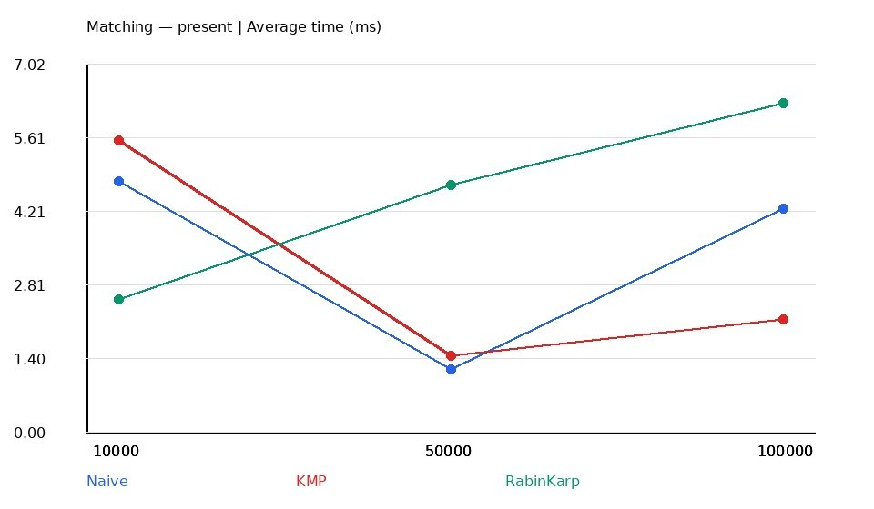
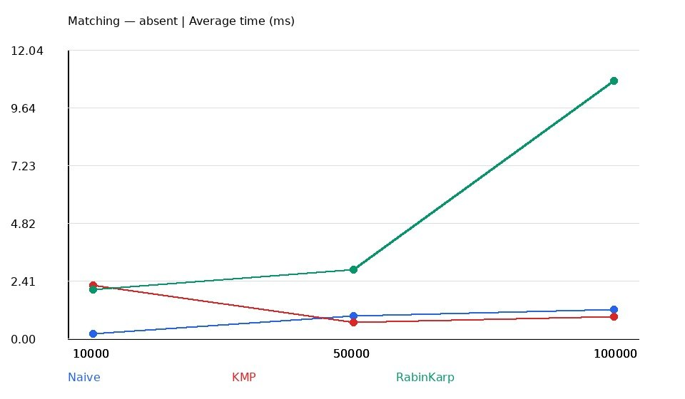
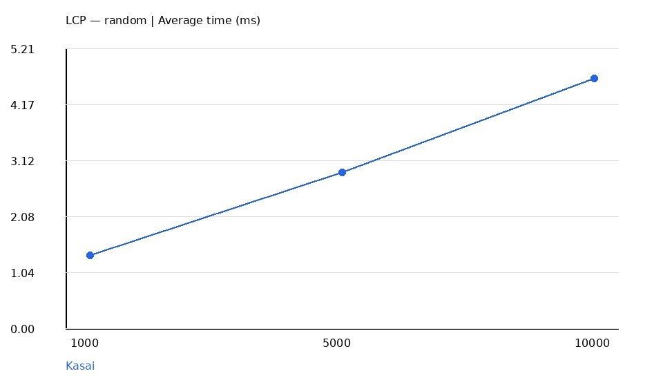

# Assignment 4 — Text Analysis: Dynamic Programming and String Algorithms

**Student:** Muratbek Ibrai  
**Group:** SE-2529  
**Course:** Design and Analysis of Algorithms  
**Programming Language:** Java  
**JDK:** 17 or higher  
**Assignment:** 4 — Text Analysis

---

# 1. Introduction

The goal of this project is to implement, test, and analyze algorithms used in text processing.

The project covers three main areas:

- Dynamic Programming
- String Matching
- Advanced String Algorithms

Six algorithms are implemented manually in Java:

1. Longest Common Subsequence (LCS)
2. Edit Distance (Levenshtein Distance)
3. Naive String Matching
4. Knuth-Morris-Pratt (KMP)
5. Rabin-Karp
6. Kasai's Longest Common Prefix (LCP) Algorithm

The project also includes correctness tests, performance benchmarks, operation counting, CSV output, and performance plots.

The main objective is to understand how these algorithms work, compare their theoretical complexity, and observe their practical performance.

# 2. Project Structure

```text
Assignment4-Text-Analysis/
│
├── src/
│   └── Main.java
│
├── results/
│   └── benchmarks.csv
│
├── plots/
│   ├── dp_times.png
│   ├── matching_present.png
│   ├── matching_absent.png
│   └── kasai_times.png
│
├── plot_results.py
├── .gitignore
└── README.md
```

### Main Components

| File | Description |
|---|---|
| `Main.java` | Contains all six algorithms, correctness tests, and benchmarks |
| `benchmarks.csv` | Stores measured execution times and operation counts |
| `plot_results.py` | Generates plots using the benchmark CSV file |
| `dp_times.png` | Compares LCS and Edit Distance |
| `matching_present.png` | Compares matching algorithms when the pattern exists |
| `matching_absent.png` | Compares matching algorithms when the pattern is absent |
| `kasai_times.png` | Shows Kasai's execution time |
| `README.md` | Project documentation and analysis |

# 3. Algorithm Implementations

## 3.1 Longest Common Subsequence (LCS)

The LCS algorithm finds the length of the longest subsequence shared by two strings.

A subsequence does not need to contain consecutive characters.

The implementation uses a two-dimensional dynamic programming table.

Let `dp[i][j]` represent the LCS length of the first `i` characters of string A and the first `j` characters of string B.

**Base cases:**

```text
dp[i][0] = 0
dp[0][j] = 0
```

**Recurrence:**

If the current characters are equal:

```text
dp[i][j] = dp[i-1][j-1] + 1
```

Otherwise:

```text
dp[i][j] = max(dp[i-1][j], dp[i][j-1])
```

The algorithm calculates each table cell using previously computed results.

**Complexity:**

- Time: O(m × n)
- Space: O(m × n)

## 3.2 Edit Distance (Levenshtein Distance)

Edit Distance calculates the minimum number of operations required to transform one string into another.

The allowed operations are:

- Insertion
- Deletion
- Substitution

The implementation uses dynamic programming.

Let `dp[i][j]` represent the minimum edit distance between two prefixes.

**Base cases:**

```text
dp[i][0] = i
dp[0][j] = j
```

**Recurrence:**

```text
dp[i][j] = min(
    dp[i-1][j] + 1,
    dp[i][j-1] + 1,
    dp[i-1][j-1] + cost
)
```

The cost is:

- 0 when the characters are equal.
- 1 when the characters are different.

**Complexity:**

- Time: O(m × n)
- Space: O(m × n)

## 3.3 Naive String Matching

Naive String Matching checks every possible starting position in the text.

At each position, it compares the pattern with the corresponding text characters.

If all characters match, the starting index is added to the result list.

The implementation also supports overlapping occurrences.

**Complexity:**

- Best case: O(n), for a non-empty pattern and n ≥ m.
- Worst case: O((n - m + 1) × m)
- Auxiliary space: O(1), excluding the result list.

## 3.4 Knuth-Morris-Pratt (KMP)

KMP improves string matching by avoiding unnecessary comparisons.

Before searching, the algorithm constructs an LPS array.

LPS means Longest Proper Prefix which is also a Suffix.

The array stores information about prefixes that are also suffixes.

When a mismatch occurs, KMP uses the LPS value to move the pattern without restarting the search from the beginning.

**Complexity:**

- LPS preprocessing: O(m)
- Searching: O(n)
- Total time: O(n + m)
- Auxiliary space: O(m)

KMP guarantees linear-time string searching.

## 3.5 Rabin-Karp Algorithm

Rabin-Karp uses hashing to search for a pattern.

It calculates a hash value for the pattern and the current text window.

A rolling hash updates the hash when the window moves to the next position.

The implementation uses:

- Base: 257
- Modulus: 1,000,000,007

When the hash values are equal, the algorithm performs character-by-character verification.

This verification is important because two different strings can have the same hash value.

**Complexity:**

- Preprocessing: O(m)
- Expected search time: O(n + m)
- Worst-case time: O((n - m + 1) × m)
- Auxiliary space: O(1), excluding the result list.

## 3.6 Kasai's Longest Common Prefix Algorithm

Kasai's algorithm constructs an LCP array using a string and its suffix array.

The LCP array stores the length of the longest common prefix between adjacent suffixes in lexicographical order.

The implementation first constructs a rank array from the supplied suffix array.

It then compares each suffix with the previous suffix in suffix-array order.

The variable `h` remembers the previously matched prefix length and helps avoid unnecessary comparisons.

**Example:**

String:

```text
banana
```

Suffix array:

```text
[5, 3, 1, 0, 4, 2]
```

LCP array:

```text
[0, 1, 3, 0, 0, 2]
```

| Suffix | Starting Index | LCP |
|---|---:|---:|
| a | 5 | 0 |
| ana | 3 | 1 |
| anana | 1 | 3 |
| banana | 0 | 0 |
| na | 4 | 0 |
| nana | 2 | 2 |

**Complexity:**

- Time: O(n)
- Auxiliary space: O(n)

The suffix-array construction used for benchmark inputs is performed separately and is excluded from Kasai's measured execution time.

# 4. Implementation Decisions and Assumptions

The following decisions were used throughout the project:

- All six required algorithms were implemented manually.
- Java standard libraries were used for collections, random input generation, file handling, and timing.
- Strings are processed using Java UTF-16 `char` units.
- Random strings use the alphabet `abcd`.
- Random seed: `42`.
- Matching indices are zero-based.
- Overlapping pattern occurrences are allowed.
- All matching algorithms return occurrences in ascending order.

### Empty Pattern Handling

An empty pattern matches every boundary position in the text.

For example:

```text
Text: abc
Pattern: ""
Result: [0, 1, 2, 3]
```

For an empty text and an empty pattern:

```text
Result: [0]
```

This behavior is applied consistently to Naive, KMP, and Rabin-Karp.

### Rabin-Karp Collision Handling

Hash equality does not automatically mean that two strings are equal.

The implementation verifies the characters whenever hash values match. This prevents incorrect matches caused by hash collisions.

# 5. Complexity Analysis

Let:

- `n` and `m` represent string lengths.
- `N` represent the length of the string used by Kasai.

| Algorithm | Best Case | Average / Expected Case | Worst Case | Auxiliary Space |
|---|---|---|---|---|
| LCS | O(mn) | O(mn) | O(mn) | O(mn) |
| Edit Distance | O(mn) | O(mn) | O(mn) | O(mn) |
| Naive Matching | O(n) | Input dependent | O((n-m+1)m) | O(1) |
| KMP | O(n+m) | O(n+m) | O(n+m) | O(m) |
| Rabin-Karp | O(n+m) | O(n+m) expected | O((n-m+1)m) | O(1) |
| Kasai | O(N) | O(N) | O(N) | O(N) |

### Complexity Discussion

**LCS and Edit Distance**

Both algorithms fill a two-dimensional dynamic programming table. Each cell is calculated once, resulting in O(mn) time and O(mn) space.

**Naive Matching**

The algorithm may compare up to `m` characters at every possible text position. Its worst-case time complexity is O((n-m+1)m).

**KMP**

The LPS table requires O(m) preprocessing time. The text is then scanned in O(n) time. The total complexity is O(n+m).

**Rabin-Karp**

Rolling hash updates take constant time per window. Its expected complexity is O(n+m), assuming few hash collisions. Frequent collisions can increase the running time.

**Kasai**

Kasai uses a rank array and a reusable prefix length to achieve O(N) time.

The returned occurrence list can require O(n) additional memory when many matches are found. This output memory is excluded from the auxiliary-space column.

# 6. Testing Strategy and Correctness

Correctness tests are implemented directly in `Main.java`.

The tests use assertions to verify expected results.

### LCS Tests

- Identical strings
- Completely different strings
- Empty string
- Classic LCS example

### Edit Distance Tests

- Identical strings
- Empty source or target
- Substitution
- Insertion
- Deletion
- Classic example: `kitten` to `sitting`

### String Matching Tests

- Pattern at the beginning
- Pattern in the middle
- Pattern at the end
- Overlapping occurrences
- Pattern absent
- Pattern longer than text
- Empty pattern
- Both text and pattern empty
- Repeated occurrences

For every matching test, Naive, KMP, and Rabin-Karp are compared against the same expected list of indices.

### Kasai Tests

- Manually verified `banana` example
- Empty string
- Repeated-character string `aaaa`

### Test Results

The correctness test run produced the following result:

```text
ALL TESTS PASSED
```

**Total: 22 successful test checks.**

No failed assertions were reported in the test run.

# 7. Experimental Evaluation

The experiments compare the practical execution time of the implemented algorithms.

The benchmark program uses Java's `System.nanoTime()` method.

### Benchmark Methodology

Each experiment follows these steps:

1. Generate the input strings.
2. Perform two warm-up runs.
3. Execute five measured runs.
4. Calculate the average execution time.
5. Save the results into `results/benchmarks.csv`.

Input generation, console output, and file writing are outside the timed regions.

The benchmark also checks that each string-matching implementation returns the same result as the reference implementation. This correctness check is performed inside the timed matching workload, so the measured time includes that validation and result-list handling.

The reported times should therefore be understood as measurements of the complete benchmark workload, not as isolated character-comparison times.

### Experimental Workloads

| Experiment | Input Sizes |
|---|---|
| LCS | 100, 500, 1,000 |
| Edit Distance | 100, 500, 1,000 |
| String Matching | 10,000, 50,000, 100,000 |
| Kasai | 1,000, 5,000, 10,000 |

### String Matching Scenarios

Two scenarios are tested.

**Present Pattern**

A 12-character substring is selected from the middle of the text.

**Absent Pattern**

The pattern is:

```text
zzzzzzzzzzzz
```

The same text and pattern are used for Naive, KMP, and Rabin-Karp during each comparison.

### Operation Counting

The implementation records relevant operation counts:

- LCS and Edit Distance count dynamic programming table cells.
- Naive counts character comparisons.
- KMP counts comparisons during LPS construction and searching.
- Rabin-Karp counts character comparisons during hash-match verification.
- Kasai records input length as a workload-size indicator, not an exact comparison count.

Operation counts should be interpreted according to these definitions. In particular, Rabin-Karp's count does not include every rolling-hash update.

# 8. Experimental Results

The following tables contain the actual measurements from `results/benchmarks.csv`.

Execution times are average milliseconds from five measured runs.

## 8.1 Dynamic Programming Results

| Algorithm | Input Size | Average Time (ms) | Operations |
|---|---:|---:|---:|
| LCS | 100 | 7.268267 | 10,000 |
| Edit Distance | 100 | 10.680577 | 10,000 |
| LCS | 500 | 14.540051 | 250,000 |
| Edit Distance | 500 | 20.971688 | 250,000 |
| LCS | 1,000 | 38.426259 | 1,000,000 |
| Edit Distance | 1,000 | 24.098919 | 1,000,000 |

## 8.2 String Matching — Present Pattern

| Algorithm | Text Length | Average Time (ms) | Operations |
|---|---:|---:|---:|
| Naive | 10,000 | 4.775734 | 13,355 |
| KMP | 10,000 | 5.550726 | 12,463 |
| Rabin-Karp | 10,000 | 2.513618 | 12 |
| Naive | 50,000 | 1.178934 | 66,555 |
| KMP | 50,000 | 1.449240 | 61,660 |
| Rabin-Karp | 50,000 | 4.704823 | 12 |
| Naive | 100,000 | 4.252037 | 133,477 |
| KMP | 100,000 | 2.134181 | 125,039 |
| Rabin-Karp | 100,000 | 6.266347 | 12 |

## 8.3 String Matching — Absent Pattern

| Algorithm | Text Length | Average Time (ms) | Operations |
|---|---:|---:|---:|
| Naive | 10,000 | 0.184415 | 9,989 |
| KMP | 10,000 | 2.203485 | 10,011 |
| Rabin-Karp | 10,000 | 2.045133 | 0 |
| Naive | 50,000 | 0.932656 | 49,989 |
| KMP | 50,000 | 0.677533 | 50,011 |
| Rabin-Karp | 50,000 | 2.856794 | 0 |
| Naive | 100,000 | 1.209577 | 99,989 |
| KMP | 100,000 | 0.900484 | 100,011 |
| Rabin-Karp | 100,000 | 10.754243 | 0 |

## 8.4 Kasai Results

| Algorithm | Input Size | Average Time (ms) | Workload Size |
|---|---:|---:|---:|
| Kasai | 1,000 | 1.352033 | 1,000 |
| Kasai | 5,000 | 2.902611 | 5,000 |
| Kasai | 10,000 | 4.649275 | 10,000 |

### Results Interpretation

The measurements show that execution time does not always increase smoothly with input size.

For example, some string-matching measurements vary because of Java runtime behavior, JIT compilation, memory allocation, garbage collection, and operating system activity.

The operation counts provide additional information about the work performed by each implementation, but they do not represent identical types of operations across all algorithms.

The theoretical complexity and the measured execution time should therefore be considered together.

# 9. Performance Plots

Four plots are generated from the benchmark CSV file using `plot_results.py`.

### 9.1 Dynamic Programming Comparison


This plot compares the execution time of LCS and Edit Distance for different input sizes.

### 9.2 String Matching — Present Pattern



This plot compares Naive, KMP, and Rabin-Karp when the pattern exists in the text.

### 9.3 String Matching — Absent Pattern



This plot compares the algorithms when the pattern does not exist in the text.

### 9.4 Kasai's Algorithm



This plot shows how Kasai's execution time changes with increasing string length.

# 10. Discussion: Theoretical vs Experimental Results

Theoretical complexity describes how an algorithm behaves as the input size increases. Experimental measurements show its actual execution time on a specific computer and under a particular runtime environment.

**LCS and Edit Distance**

Both algorithms have O(mn) time complexity. Their dynamic programming tables contain one million cells when both input strings have length 1,000.

**Naive String Matching**

Naive matching is simple and can perform well on some inputs. However, its worst-case complexity is higher because it can repeat character comparisons at many positions.

**KMP**

KMP uses the LPS array to avoid unnecessary comparisons. Its theoretical searching complexity is O(n+m).

**Rabin-Karp**

Rabin-Karp uses rolling hashes to process text windows. Its performance depends on hash calculations, verification, and possible collisions. The measurements show that a theoretically efficient approach is not automatically the fastest in every tested workload.

**Kasai**

Kasai has linear time complexity when a correct suffix array is already available. The suffix-array construction is separate and is not included in the measured Kasai execution time.

Actual execution times can also be affected by Java JIT compilation, garbage collection, memory allocation, and operating system activity.

Therefore, theoretical complexity and experimental results should be evaluated together.

# 11. Conclusion

In this assignment, six algorithms for text analysis were implemented and tested using Java.

The project demonstrates how dynamic programming can solve problems such as LCS and Edit Distance.

It also demonstrates the differences between three string-matching approaches:

- Naive matching is simple but can be inefficient in the worst case.
- KMP guarantees linear-time searching.
- Rabin-Karp uses rolling hashes and collision verification.

Finally, Kasai's algorithm demonstrates how an LCP array can be constructed efficiently using a suffix array.

The correctness tests, benchmark experiments, operation counts, CSV results, and performance plots provide a practical way to evaluate the algorithms.

The main conclusion is that there is no single best algorithm for every situation. The choice depends on input size, memory requirements, data characteristics, and performance guarantees.

# 12. How to Run the Project

### Requirements

- Java JDK 17 or higher
- Python 3
- Python `matplotlib` library

### Compile the Java Program

```bash
mkdir -p out
javac --release 17 -d out src/Main.java
```

### Run Correctness Tests

```bash
java -cp out Main test
```

Expected final message:

```text
ALL TESTS PASSED
```

### Run Benchmarks

```bash
java -cp out Main benchmark
```

The program generates:

```text
results/benchmarks.csv
```

### Generate Performance Plots

Install matplotlib:

```bash
python3 -m pip install matplotlib
```

Run:

```bash
python3 plot_results.py
```

The generated plots are saved in the `plots/` directory.

### Run Tests and Benchmarks Together

```bash
java -cp out Main all
```

# 13. Final Project Information

**Project:** Assignment 4 — Text Analysis  
**Student:** Muratbek Ibrai  
**Group:** SE-2529  
**Course:** Design and Analysis of Algorithms  
**Programming Language:** Java  
**Main Topics:** Dynamic Programming, String Matching, Complexity Analysis, Experimental Evaluation

**Repository:** Assignment4-Text-Analysis

---

**End of Report**
